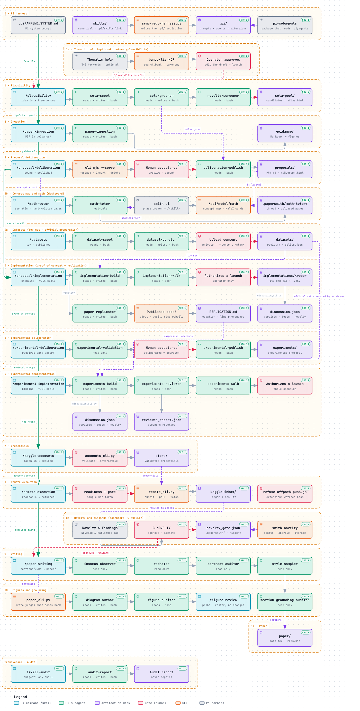

# papersmith-ai

> **A paper forge**: turns reference PDFs into high-fidelity Markdown that an agent can read (equations in LaTeX, tables as tables, figures as files), and drives the formal deliberation —mathematics and experimental design— through to the code that tests itself and the compiled paper.

[](https://github.com/LIAUNAL/papersmith-ai/actions/workflows/test.yml)
[](https://nodejs.org/)
[](https://www.python.org/)

<p align="center">
  
</p>

This README is the **way in**: what papersmith is, how to install it, the order of
the work, the workspace from the inside, development and troubleshooting. The
reference pages live under [docs/](docs/README.md): every skill in
[docs/skills.md](docs/skills.md) and every `smith` command in [docs/cli.md](docs/cli.md).

## Contents

1. [If this is your first time](#if-this-is-your-first-time)
2. [Use flow — the short path](#use-flow--the-short-path)
3. [Getting started](#getting-started)
4. [How it works — the order](#how-it-works--the-order)
5. [Inside the workspace](#inside-the-workspace)
6. [Harnesses and skill projection](#harnesses-and-skill-projection)
7. [The agents](#the-agents)
8. [Anatomy of each skill](docs/skills.md#anatomy-of-each-skill)
9. [The CLI commands](docs/cli.md#the-cli-commands)
10. [Remote compute, carefully](#remote-compute-carefully)
11. [Architecture](#architecture)
12. [Development and testing](#development-and-testing)
13. [Troubleshooting](#troubleshooting)
14. [Related documentation](#related-documentation)
15. [License](#license)

## If this is your first time

Welcome. This forge is built to take a PDF to a compiled paper
without guessing the order. The minimum path:

1. **Install the CLI and set up the environment** — see [Getting started](#getting-started).
2. **Create your workspace** — `smith init ~/papers/my-paper --title "…" --topic "…"`.
   What it leaves inside, in [Inside the workspace](#inside-the-workspace).
3. **Check that the idea is plausible** — with your idea in two sentences,
   `/plausibility` tracks the SOTA and returns the constellation plus a ranked top 5.
4. **Put a reference PDF** in `guidance/reference-papers/` and run
   `smith ingest <pdf>` — or ask for `/paper-ingestion` inside your harness.
5. **Open the deliberation** with `/proposal-deliberation` and discuss the mathematics
   with the agent.

Not every skill has to be used, or in this order: **each one declares what
it needs first and refuses before doing something half-done**. If an input is
missing it doesn't invent it: it exits with a rejection code that names what's missing. A
`PAPER_ABSENT` reports a missing input, not an operator error.

The full map is in [Use flow](#use-flow--the-short-path); the
detailed route, in [How it works — the order](#how-it-works--the-order). If an AI
agent is used as a copilot, the ones already defined are in
[The agents](#the-agents).

---

## Use flow — the short path

Every skill is invoked by name in Claude Code (`/paper-ingestion`) or requested in
Spanish (*"ingiere los papers"*). **Not all of them have to be used, or in this order**: each
one declares what it needs first and refuses if it's missing, so an invocation from the middle
of the flow reports which input is missing.

The full path, from a PDF to a compiled paper:

| # | You invoke | What it does | Where it leaves the result |
|---|---------|----------|-------------------------|
| 1 | `/plausibility` | Explores the idea before any ingestion, in three stretches: it tracks ~25 references through their abstracts, maps the constellation in a single HTML and discusses the plausibility of the hypothesis against that SOTA | `sota-pool/` (ignored, like `guidance/`) |
| 2 | `/paper-ingestion` | Converts the reference PDFs into readable Markdown (equations in LaTeX, tables as tables, figures as files) | `guidance/<folder>/` |
| 3 | `/proposal-deliberation` | Discusses the mathematics with you and publishes each agreement as a managed revision, with the SOTA constellation alongside | `proposals/` (the revision and its `graph.html`) |
| 3b | `/math-tutor` | Before implementing a revision: a Socratic tutor that discusses its concept map and mathematics with you, reads the pages you draw by hand, and checks your understanding of why the novelty holds | nothing on disk but its thread (`.papersmith/math-tutor/`); used from the dashboard's Mapa Conceptual & Modelo tab |
| 4 | `/datasets` | Gives the proof of concept and the full experiments their data: a seeded toy set always (`synth`), then an official dataset searched for (`search`) across the paper's own repository and the open dataset hosts, its source license decided (`license`), its quality measured (`qc`) and one subject-wise preparation both stages read (`prepare`); `publish` uploads it privately only with your explicit consent. Agents `dataset-scout` and `dataset-curator` | `datasets/` (registry, toy and prepared sets) |
| 5 | `/proposal-implementation` | Proof of concept: turns the proposal into Python that verifies itself against the document | `implementations/<repo>/` |
| 5b | `/proposal-implementation` (replication) | Replicates each comparison or baseline paper through the `paper-replicator` agent: it looks for the paper's published code first and, when it exists, adopts it pinned to a commit and audits that it corresponds to the paper and is implemented correctly; only when no code exists does it reimplement the method from the ingested Markdown | the target repo, with a `REPLICATION.md` correspondence table |
| 6 | `/experimental-deliberation` | Discusses the experimental design that will put that mathematics to the test | `experiments/` |
| 7 | `/experimental-implementation` | Turns the protocol into code and runs its measurements | the same target repo |
| 7b | `/experiment-diagrams` | When the proof of concept (`AGREED.md`) and then the full experiments (`Experimental_AGREED.md`) are approved, draws one TikZ diagram of each, stating the experiment's single claim along one reading spine, compiles it to PDF and PNG and reviews it, grayscale included | `implementations/<repo>/<Name>/diagrams/`, shown in the Experimentos panel |
| 8 | `/kaggle-accounts` | Proves that the Kaggle credentials really authenticate | `store/` (never leaves the disk) |
| 9 | `/remote-execution` | Sends work to a remote worker and keeps the record of what came back | the target repo's ledger |
| 10 | `/paper-writing` | Writes the paper block by block, with every claim tied to its evidence | `paper/` |
| 11 | `/figure-review` | Looks at the render: rasterizes every `Figures/<id>.pdf` and measures what a raster can support (ink outside the canvas, collisions) | a visual report, never a change |
| 12 | `/skill-audit` | Audits any of the above: what the code accepts versus what its documentation promises | a report, never a change |
| 13 | `/upgrade-project` | Brings the workspace to the version of the CLI you have installed: it syncs the kit files and migrates the artifacts, delegating everything to `smith upgrade` | the workspace itself |

The minimum to try the forge is step 1: with the idea in two sentences,
`/plausibility` tracks the SOTA and returns the constellation plus the top-5. Only
afterwards, if desired, a PDF can be placed in `guidance/reference-papers/` and run
through `/paper-ingestion`; the deliberation is then carried out with
`/proposal-deliberation`. Steps 5 to 7 only make sense once there's a published proposal
and a target repository to implement it in.

The diagram shows the full flow: every stage in this order with
its command, its agents (with the tools each one declares in Pi), its
human gates and what it leaves on disk. The interactive version, with links to
the source of each node, is in
[`docs/diagrams/papersmith-pi-flow.html`](docs/diagrams/papersmith-pi-flow.html)
(opens in the browser; generated with [Archify](https://github.com/tt-a1i/archify),
and its source and its recipe are versioned in
[`docs/diagrams/`](docs/diagrams/README.md)).

The dashboard (`smith ui`) opens on this flow and shows the same order as
eleven phases under **Pipeline y Avance**. Below the diagram, the **Flujo Archify**
tab lists every agent the workspace ships (`/api/agents`): its role, the skill it
loads, its stretch, its tools, the phase(s) it acts in and the harnesses it is
projected to, in a table you can sort and filter. Clicking a phase opens its console:
a text box with the stage's rules as a guide that sends `/<skill> <text>` to an
agent in the support terminal (for `/plausibility`, the idea in at least two
sentences), the real `smith` command for the phase, or a link to the panel
that owns the work: the concept map, the math tutor, the PoC board, the
sections, the PDF preview or the gates. After "Ejecutar", the drawer tracks the run
step by step until the server finds the phase's evidence on disk and marks it
verified; the next phase then unlocks and lights up. Each phase is locked until
the one before it passes (override available). A running phase also shows in a
dock at the bottom left on every tab. A click opens its tracking panel in place, with
the checkpoints, the agent's terminal and **⏹ Detener proceso**, which interrupts the
agent's turn and keeps its session. Closing the CLI, changing tabs or reloading the
page never ends the session of a running phase: a reload reattaches to it. The same eleven phases are written into
every harness entrypoint (`CLAUDE.md`, `OPENCODE.md`, `.pi/APPEND_SYSTEM.md`,
`.agents/AGENTS.md`) under "Paper construction flow".

[](docs/diagrams/papersmith-pi-flow.html)

1. **Nothing produced gets uploaded.** `proposals/`, `experiments/`, `paper/`,
   `implementations/` and `sota-pool/` travel to GitHub **as empty folders** and nothing more; `guidance/`
   versions its folders and never the PDFs or the Markdown inside. The scaffolding gets
   versioned, the content doesn't. A half-written paper is research material, and
   publishing it by accident is a leak.
2. **Each skill refuses before doing something half-done.** If an input is missing, it
   doesn't invent it or skip it: it exits with a rejection code that names what's missing. A
   `PAPER_ABSENT` or a `SECTION_CONTRACTS_UNREADABLE` names what the skill is missing, not an
   operator error.
3. **The operator closes the deliberation.** The two deliberation skills propose, discuss and
   prepare the edit, but neither publishes without the operator's acceptance. It is part of
   each one's contract, and the engine enforces it.

---

## Getting started

None of this requires keys or external services: the forge runs locally.

### 0. What your machine needs to have

Two runtimes, and both are mandatory: the forge uses Python for the CLI and Node
for the deliberation engine, and without the second one half the framework won't
start.

| Runtime | Version | What for | If it's missing |
| --- | --- | --- | --- |
| **Python** | ≥ 3.11 | the `smith` CLI and all the Python skills | there's no possible installation |
| **Node.js** | ≥ 21 | the deliberation engine (`jiti`, `typebox`) and the dashboard | `init` warns and `deliberate` refuses |
| `npm` | whatever Node ships | installing those two dependencies in the workspace | same as above |

Both are checked at once:

```bash
python3 --version && node --version && npm --version
```

If Node is missing, `smith init` doesn't fail: it warns with
`npm was not found; deliberate requires npm install for jiti/typebox` and moves
on, because the rest of the workspace can be created. But `proposal-deliberation`
and `experimental-deliberation` —the two skills that propose and discuss before
writing— don't run without those dependencies. To create the workspace without
them, `init --no-npm` does so explicitly.

The ingestion runtime from step 2 is separate and **is optional**: it's only
needed to extract PDFs with OCR.

### 1. Install the CLI and set up the environment

```bash
# 1a. The CLI, from the latest version published on PyPI
pipx install papersmith-ai
#     the same with pip, for setups without pipx
pip install papersmith-ai
#     or the tip of `main`, without waiting for a release
pipx install git+https://github.com/LIAUNAL/papersmith-ai.git

# 1b. Or from a clone of `main` (for framework development)
git clone https://github.com/LIAUNAL/papersmith-ai.git && cd papersmith-ai
pipx install .            # with pip: pip install .

# 1c. Update the CLI when a new release comes out
pipx upgrade papersmith-ai
#     `upgrade` doesn't see a git-URL install: reinstall
pipx install --force git+https://github.com/LIAUNAL/papersmith-ai.git
#     with pip, `--upgrade` over a git URL doesn't always re-clone
pip install --upgrade --force-reinstall "papersmith-ai @ git+https://github.com/LIAUNAL/papersmith-ai.git"

# 1d. Bring existing workspaces up to that version
smith upgrade --plan-migrations ~/papers/sparse-ae  # which artifacts are missing, without writing anything
smith upgrade ~/papers/sparse-ae                    # syncs the files and migrates the artifacts
smith status ~/papers/sparse-ae                     # drift and pending migrations

# 2. Isolated ingestion runtime (micromamba: Python 3.12, PyTorch, Surya OCR, llama-server)
python3 scripts/setup_env.py install

# 3. Node dependencies and projection of skills to the harnesses
npm install
npm run setup:harnesses
```

**The command is `smith`.** Installing `papersmith-ai` puts `smith` on `PATH`,
and every command in this README uses it (`smith init`, `smith upgrade`,
`smith status`, …). The older `papersmith` entry point is still installed as a
compatibility alias for existing scripts; it runs the same CLI and reports itself
as `smith`.

**The package is published on PyPI.** `pipx install papersmith-ai` brings the
latest release, which `pipx upgrade papersmith-ai` in **1c** updates. The git URL
in **1a** brings the tip of `main`, for framework development. The neighbouring
name `papersmith` —without the `-ai`— is also on PyPI, but it's **another
project** (Word document generation), so `pip install papersmith` doesn't install
this forge.

`main` is the only branch that's maintained, and each release also gets its tag,
so an exact build is frozen by pinning it in the URL — for example
`pipx install --force "git+https://github.com/LIAUNAL/papersmith-ai@v0.25.0"`.
**1b** takes the clone as it is, including uncommitted changes; a reproducible
build comes from **1a** or a tag. The changelog is in [CHANGELOG.md](CHANGELOG.md).

Updating is two steps and they're two different objects. **1c** reinstalls the
CLI from `main`; `smith --version` confirms the installed version. **1d**
moves each **workspace** that already exists, and it isn't optional: a release
can change the shape of an artifact a workspace has already produced —the graph
pool's `atlas.html`, for example—, so syncing the framework files without
migrating the artifacts leaves the new scaffolding reading old state.

`smith upgrade` syncs the workspace with the installed version and applies
that version's artifact migrations. The version the workspace records doesn't
advance until those migrations are done, so `smith status` may report that
it hasn't yet reached the release just installed. `--plan-migrations` reports
what's pending and finishes without writing anything; it isn't called
`--dry-run`, because it doesn't preview the kit copy. `--no-migrate`
syncs the files and leaves the artifacts as they are, with the version marker
where it was.

**Which workspaces can be upgraded.** Re-initializing a live workspace is never
the answer: `smith init` in a fresh directory leaves behind every ledger,
receipt, seal, managed revision and lock the paper has accumulated. Workspaces
recorded at 0.12.0 or later are supported, and since 0.14.0 every release that
changes the shape of something a workspace already has ships its migration in
the same release (or a compatible read that keeps reading the old shape). A
workspace older than 0.12.0 also upgrades —the files are synced and the
convergence migrations run—, but shape changes from before 0.12.0 shipped no
migration and leftovers may remain (the `.antigravity/` folders of 0.8.0 are not
removed). With no recorded version, the version-gated migrations stay
`undetermined` and are not applied; a version that cannot be ordered, or one
newer than the kit, is refused unless you pass `--allow-downgrade`. The
maintainer-side policy is in
[`docs/releasing.md`](docs/releasing.md#workspace-support-policy).

The two `upgrade`s are separate: neither one touches the other.
`smith upgrade` refuses to take a workspace to a version older than the one
it records, unless `--allow-downgrade` is passed.

`scripts/setup_env.py install` provisions **the whole** ingestion stack in a
separate micromamba environment (CPU or CUDA, depending on what it detects),
including the `llama-server` binary that the OCR needs — it is **not** Ollama
nor a Homebrew installation. The micromamba it bootstraps is a pinned release
whose SHA-256 is checked before it runs; the comment above `MICROMAMBA_VERSION`
in `scripts/setup_env.py` is the procedure for moving the pin.
`npm run setup:harnesses` symlinks the canonical
`skills/` tree into `.claude/skills`, `.pi/skills`, `.opencode/skills`
and `.agents/skills`, with relative, idempotent symlinks (see
[Harnesses and skill projection](#harnesses-and-skill-projection)). The first
run of `smith ingest` downloads ~1.5 GB of Surya weights if the
environment wasn't pre-provisioned.

### 2. Create a workspace

```bash
smith init ~/papers/sparse-ae \
  --title "Sparse Autoencoder Audit" \
  --topic "mechanistic interpretability" \
  --remote kaggle

cd ~/papers/sparse-ae
smith status
smith status --json          # machine-readable snapshot
```

The workspace stays decoupled from the framework checkout: the scaffolding is
synced with `smith upgrade`, and the research artifacts are protected by
contract. What `init` creates exactly —and what gets versioned— in
[Inside the workspace](#inside-the-workspace).

### 3. Ingest literature

```bash
smith ingest https://arxiv.org/abs/2309.08600    # arXiv, OpenReview or URL
smith ingest ~/Downloads/reference-paper.pdf     # local PDF
smith ingest ~/Downloads/scan.pdf --ocr       # scanned: balanced OCR mode
```

Each loose PDF ends up in its own folder, next to its Markdown (text + LaTeX +
tables, with the bibliography stripped) and the images of its figures. The
pipeline's details, in the `paper-ingestion` section of the
[Anatomy](docs/skills.md#anatomy-of-each-skill).

### 4. Deliberate, implement and run

```bash
smith deliberate . --action status                                   # state of the managed proposal
smith implement . --action verify --target implementations/my-repo   # over an already materialized repo
smith run smoke_and_invariants --dry-run                             # plans; dispatches nothing
```

Inside a harness, the same capabilities are requested by skill name:
`/paper-ingestion`, `/proposal-deliberation`, `/experimental-deliberation`,
`/proposal-implementation`, `/experimental-implementation`, `/paper-writing`.
The ones that don't depend on a domain — `/kaggle-accounts`,
`/remote-execution`, `/skill-audit` — act as gatekeeper, memory and auditor of
what is sent out.

---

## How it works — the order

### Step 1 — Check that the idea is plausible (`plausibility`)

Before there is anything to ingest there is an idea, and this is the step that
tests it. It needs no PDFs, which is why it comes first: all three stretches work
from the idea and from what can be found about it.

| Stretch | Runs as | Ends at |
| --- | --- | --- |
| **Scout** | the `sota-scout` agent | the pool — 25 candidates with abstracts, in 3 to 5 families, plus the provisional plausibility note |
| **Constellation** | the `sota-grapher` agent | the single `atlas.html` beside `atlas.json`, with the checker's green run |
| **Screen** | the `novelty-screener` agent | the plausibility report — graded claims, a ranked top 5, and one closing paragraph on where the proposal stands |

Everything lands in `sota-pool/`, which is ignored like `guidance/`.
**Nothing here files into `guidance/`**: this step reads the literature, it does
not collect it. The pool it leaves behind is what `proposal-deliberation` shows
alongside the mathematics, and its ranked top 5 is what tells the ingestion step
which PDFs are worth having.

An idea stated in fewer than two sentences is refused before the search starts:
scouting an unstated idea invents its own question. A claim with no abstract
passage behind it does not become a planet — a quoteless planet is a drawing.

### Step 2 — Put each PDF in the folder according to its role

| Folder | What goes here |
|---------|------------|
| `guidance/paper-guide/` | **Guide papers** — the methodological / style references. `proposal-deliberation` loads them as context at the start of each deliberation. |
| `guidance/reference-papers/` | **Reference corpus** — supporting papers, ingested to Markdown for consultation. They aren't loaded automatically into the deliberation. |
| `guidance/data-paper/` | **Data paper — mandatory for `experimental-deliberation`.** It describes the research's database and is the **ceiling**: it bounds what can be claimed. A claim the data doesn't support isn't an experiment. Without this folder populated, `CREATE_INITIAL_REVISION` can't start. |

**All three folders travel empty.** Each one arrives in a clone with its `.gitkeep` and nothing more: `guidance/*/*` is ignored, with `!guidance/*/.gitkeep` as the only escape hatch. The scaffolding is versioned, the PDFs and their Markdown are not. `tests/test_forge_scaffolding.py` derives both halves —what the `profile.ts` declare as source against what git actually tracks— and goes red if a declared folder stops travelling.

### Step 3 — Ingest the PDFs (PDF → Markdown)

In **Claude Code**, the skill is invoked:

```
/paper-ingestion
```

(or, in Spanish: *"ingiere los papers"*). For each **loose** PDF, it creates a
folder with the paper's name, moves the PDF inside and writes a lightweight
`<name>.md` (text + LaTeX + tables, with the bibliography stripped) together
with the images of the figures:

```
guidance/reference-papers/computers-13-00176-v2-1/
├── computers-13-00176-v2-1.pdf
├── computers-13-00176-v2-1.md
└── _page_4_Figure_2.jpeg   (figures that the .md references)
```

A **loose PDF** (directly in a source root folder) is pending; a paper that's
already inside its folder is skipped. Re-ingesting means deleting the paper's
folder (leaving the PDF loose) and running the skill again. The configuration
lives in `papersmith.yaml` (`source_roots`, `mode`, `strip_references`,
`force_ocr`). If a PDF's tables come out scrambled because its text layer is
bad, `--force-ocr` (or `force_ocr: true`) rebuilds every page by OCR instead of
reading that layer.

### Step 4 — Deliberate over a proposal (`proposal-deliberation`)

In **Claude Code**, the skill is invoked:

```
/proposal-deliberation
```

On the first turn it automatically loads the Markdown from `guidance/paper-guide/`
as context and acts as a mathematics tutor. The available actions:

- describe an idea and ask for a first version,
- ask for edits to a managed proposal,
- run the lifecycle of managed revisions.

Proposals live in `proposals/`, one per managed revision
(`research-concept-rNN.md`).

Each published revision travels with its own constellation: the SOTA's with the
proposal inside, in `proposals/research-concept-rNN.graph.html`, drawn by the
same 3D viewer as the atlas and named from the revision. The deliberation's
publication stretch produces it, from the `proposals/research-concept-rNN.sky.json`
overlay written during the discussion: there the main idea, the topics the
proposal takes from the SOTA papers, its novelty, the problem it would solve and
three to five concepts remain as nodes and edges instead of as sentences. If
that overlay doesn't exist, the stretch reports it as pending instead of drawing
relationships nobody agreed on.

### Step 5 — Take the proposal to code (`proposal-implementation`)

In **Claude Code**, the skill is invoked:

```
/proposal-implementation
```

It takes the current revision and materializes it in a target repository, which
lives in `implementations/` with its own git and its own virtual environment. The
flow has two separate phases:

1. **Structure.** If the repo comes with content, it moves it to the layout and
   verifies —without running anything— that notebooks, paths and references
   still resolve. It doesn't audit or validate the code that was already there:
   it's what's there, tidied up.
2. **Materialization.** Only then does it implement the mathematics and subject
   it to the validation ladder.

```
<repo>/
├── <Name>/            Notebooks/  Data/  Results/  Models/
├── src/<Package>/     one implementation per mathematical object
├── tests/             smoke · invariants · synthetic · audit · remedies
└── pyproject.toml
```

The ladder has five levels, from the cheapest to the most expensive: **smoke**,
**invariants** (each claim of the proposal anchored to a test), **synthetic**
(deterministic, fixed seed), **audit** (findings about the mathematics, measured
over 200 random configurations) and **remedies** (each proposed fix validated
with the same rigour). A finding without a validated remedy isn't reported.

That is all that is needed to use the forge. **What goes on inside** each
skill —its steps, its pieces, how they connect to each other and what
limitations each one has— is detailed in [Anatomy of each
skill](docs/skills.md#anatomy-of-each-skill). For the literal contract, each one's
`SKILL.md`.

---

## Inside the workspace

`smith init` creates a self-contained directory —with no git initialized and
without touching the framework checkout— with this shape:

```
my-paper/
├── .papersmith/                 # workspace state (config, manifest, ledger)
│   ├── config.json              #   active target and profile, ledger paths
│   ├── manifest.json            #   hashes of everything the framework generated
│   ├── runs_ledger.jsonl        #   every dispatched run, in order
│   └── version                  #   framework version that created it
├── .claude/agents/              # the twenty-four subagents (single source of truth)
├── skills/                      # the kit copy: the skills + _core
│   └── _core/                   #   the two shared engines (deliberation, implementation)
├── sections/                    # the ten section contracts (they travel WITH content, like skills/)
├── guidance/
│   ├── reference-papers/        # drop-zone: reference PDFs go here
│   ├── paper-guide/             # guiding papers for method and style (optional but recommended)
│   └── data-paper/              # data paper (mandatory for experimental-deliberation)
├── proposals/                   # managed revisions, flat: research-concept-rNN.md
├── paper/                       # the paper's LaTeX (paper-writing writes it here)
├── experiments/                 # the managed experimental protocol
├── implementations/             # destination repos; each one with its own git
├── kaggle-inbox/                # what comes back from the remote workers
├── CLAUDE.md / OPENCODE.md / .agents/AGENTS.md   # harness routing
├── .pi/APPEND_SYSTEM.md         # harness routing (Pi appends it to the system prompt)
├── papersmith.yaml              # workspace configuration (editable)
├── package.json                 # workspace Node dependencies (jiti, typebox), editable
├── requirements.txt
├── scripts/setup_env.py         # ingestion runtime provisioning
└── README.md                    # brief description of the workspace
```

Every research folder (`guidance/*/`, `proposals/`, `paper/`, `experiments/`,
`implementations/`) arrives empty, with its own `.gitkeep`: the workspace's
`.gitignore` applies the same rule this repository applies to itself —the
folder is versioned, the content never is.

### `papersmith.yaml` — the configuration you will actually touch

The file comes with three example targets and three execution profiles. The
targets declare **where** the work runs; the profiles, **what** runs and how
it is split up:

```yaml
compute_targets:
  default: "kaggle-gpu-pool"
  targets:
    local-workstation: { provider: "local", device: "cuda:0" }
    kaggle-gpu-pool:   { provider: "kaggle", accelerator: "GPU_T4_X2", ... }
    slurm-cluster:     { provider: "remote-ssh", host: "hpc.university.edu", ... }

execution_profiles:
  smoke_and_invariants:  { target: "local-workstation", entrypoint: "{target_python} -m pytest {target}/tests/test_invariants.py" }
  sweep_training:        { target: "kaggle-gpu-pool", sharding: { … }, artifacts: { … } }
  benchmark_evaluation:  { target: "kaggle-gpu-pool", entrypoint: "papermill …/benchmark.ipynb" }

paper_ingestion:
  engine: auto          # route each page: pypdfium2 fast path, Docling only where needed
  mode: fast            # fast (route pages) | balanced (every page through Docling)
  strip_references: true
  source_base: guidance
```

The active target and profile live in `.papersmith/config.json`; `papersmith
target set` changes them. The `paper_ingestion` block is owned by the ingestion
skill and the orchestrator treats it as opaque (it is edited with the skill, not
by hand).

### What is versioned and what is not

`smith upgrade`'s preservation contract is explicit: it never touches
`guidance/`, `proposals/`, `paper/`, `experiments/`, `implementations/`,
`kaggle-inbox/`, `papersmith.yaml`, `package.json`, `README.md`
nor the `.env*` files. Everything else is framework scaffolding and `upgrade`
syncs it —with `--force` if needed— leaving the artifacts intact.

In this repository the same rule holds for Git: the scaffolding is versioned,
the content is not. Research folders travel with their `.gitkeep` and nothing
else; `guidance/` versions the folders and never the PDFs nor the ingested
Markdown. `sota-pool/` follows the same contract: the folder travels, and
`candidates.json`, `atlas.json` and `atlas.html` —which inlines the full 3D
viewer— stay on the machine that produced them.

Preserving is not migrating. Not touching an artifact protects it while
its shape does not change; the day a release changes that shape, something is
needed to carry it up to it. That is the job of [artifact
migrations](docs/cli.md#artifact-migrations), and it is also the reason
`.papersmith/version` stopped advancing just because files had been copied.

### The state: `.papersmith/`

- **`manifest.json`** stores the hash of every generated file. `papersmith
  audit --check-drift` compares against the disk and names what drifted; the
  repair is `smith upgrade`, never a hand edit.
- **`runs_ledger.jsonl`** is append-only: every `smith run` that gets
  dispatched is recorded with its target, its profile and its result.
- **`config.json`** stores the active target, the active profile and the ledger's
  configuration paths.
- **`migrations.json`** records which version-tied artifact migrations have
  already been applied, so that `upgrade` does not repeat them. Convergence
  ones are never recorded: they never end. If the file gets damaged,
  `upgrade` refuses and `status` reports it; it must not be edited by hand.
- **`version`** is the version the workspace declares for its **artifacts**,
  not for its files. Of the two markers it is the one that lags behind when
  a migration fails, and that is why `status` can say the workspace has not
  yet reached the installed release.

---

## Harnesses and skill projection

`skills/` at the repository root is the **single source of truth**. Each
harness reads skills from its own folder, so the projection script symlinks
the canonical tree into each one with **relative** and idempotent symlinks:
running it again converges to the same layout and the checkout stays
relocatable.

```bash
npm run setup:harnesses      # = bash scripts/setup-harnesses.sh
```

| Harness | Where it reads skills from | Routing document (workspace) |
|---------|----------------------------|-------------------------------|
| Claude Code | `.claude/skills/` | `CLAUDE.md` |
| Pi | `.pi/skills/` | `.pi/APPEND_SYSTEM.md` |
| OpenCode | `.opencode/skills/` | `OPENCODE.md` |
| Google Antigravity | `.agents/skills/` | `.agents/AGENTS.md` |

### What each harness wires

`smith init` and `smith upgrade` generate, for each harness the
workspace declares, what this table shows. It is the same matrix as
`HARNESS_CAPABILITIES` in `src/papersmith/generators.py`, and a test
(`tests/test_harness_parity.py`) verifies that both match. `wired` is what
gets generated; `unsupported` is what does not get generated; `opt-in` is
only documented, and it is enabled manually.

<!-- harness-capabilities:start -->
| Harness | Skills | Comandos | Agentes | Plugins / guards |
|---------|--------|----------|---------|------------------|
| Claude Code | wired | wired (`.claude/commands`) | wired (`.claude/agents`) | opt-in (ver [guard-hooks](docs/guard-hooks.md)) |
| OpenCode | wired | wired (`.opencode/commands`) | wired (`.opencode/agents`) | wired (`.opencode/plugins/refuse-offpath-push.js`) |
| Pi | wired | wired (`.pi/prompts`) | wired (`.pi/agents`) | wired (`.pi/extensions/refuse-offpath-push.js`) |
| Google Antigravity | wired | unsupported — vía skills (workflows deprecados) | wired (`.agents/agents`) | unsupported |
<!-- harness-capabilities:end -->

When it finishes, `init` and `upgrade` print one line per active harness with
the state of each capability (`wired`, `unsupported`, `failed` or `blocked`) and
add the `wiring` key to its result. If a skill symlink could not be created, or
there is a real directory where the symlink would go, they report it as a warning
(`failed` / `blocked`) instead of silently omitting it.

Pi's agents use the web tools `web_search` and `fetch_content` from the
[`pi-web-access`](https://www.npmjs.com/package/pi-web-access) package. The
workspace declares it in `.pi/settings.json`, which Pi reads once you trust the
project and installs from there; nothing needs installing by hand. `init` writes
that file, `upgrade` adds it to an older workspace that lacks it, and neither
touches an existing one (add packages to it with `pi install -l <source>`).

What the table does not promise:

- **Pi:** the agents in `.pi/agents` are only read by the third-party package
  `pi-subagents`; the Pi core has no subagents. Without that package, the
  files exist but remain unused.
- **Claude Code:** the guard is opt-in. Papersmith never writes or merges
  `.claude/settings.json`; the snippet to enable it is in
  [`docs/guard-hooks.md`](docs/guard-hooks.md).
- **Antigravity:** there is no guard until its hooks' input schema is obtained
  (`.agents/hooks.json`).
- **Antigravity, commands:** no command files are generated. Its only
  slash-command mechanism, workflows, is deprecated in favor of skills
  (retirement 2026-11-01) and the workflows' workspace path is not verified
  (`.agents/workflows` is an assumption). Skills already work as
  `/<skill-name>` through `.agents/skills`, so all of them stay invocable
  as commands.
- **Antigravity, documented locations only:** `.antigravity/rules.md` and
  `.antigravity/skills` are no longer generated. Antigravity uses `.agents/skills`,
  `.agents/agents/` and `.agents/AGENTS.md` (plain text, no frontmatter). Existing
  workspaces are not migrated: `smith init` must be run in a new workspace.

#### Verified support matrix

Summary of [`docs/harness-support-matrix.md`](docs/harness-support-matrix.md),
read against each tool's documentation on 2026-10-02. It is what the
tool documents, not what Papersmith generates (that is the table above).
`unverified` means no primary source was read.

| Harness | Skills | Commands | Agents | Plugins / hooks | MCP / config | Sources (2026-10-02) |
|---------|--------|----------|--------|-----------------|--------------|----------------------|
| OpenCode | supported: `.opencode/skills` | supported: `.opencode/commands` | supported: `.opencode/agents` | supported: `.opencode/plugins/` | supported: `opencode.json` | <https://opencode.ai/docs/skills/>, <https://opencode.ai/docs/commands/>, <https://opencode.ai/docs/agents/>, <https://opencode.ai/docs/plugins/>, <https://opencode.ai/docs/config/> |
| Pi | supported: `.pi/skills`, `.agents/skills` | supported: `.pi/prompts/*.md` | unsupported in the core; third-party only (`.pi/agents`, `pi-subagents`) | supported: `.pi/extensions/` | supported: `.pi/mcp.json` | <https://github.com/badlogic/pi-mono/blob/main/packages/coding-agent/docs/configuration.md>, <https://github.com/badlogic/pi-mono/blob/main/packages/coding-agent/docs/prompt-templates.md>, <https://github.com/badlogic/pi-mono/blob/main/packages/coding-agent/docs/extensions.md>, <https://github.com/badlogic/pi-mono/blob/main/packages/coding-agent/docs/mcp.md>, <https://github.com/nicobailon/pi-subagents/blob/main/docs/agents.md> |
| Google Antigravity | supported: `.agents/skills` | supported but deprecated (workflows); path `.agents/workflows` unverified | supported: `.agents/agents` | supported: `.agents/hooks.json` (input schema unverified) | supported: `.agents/mcp_config.json` | <https://antigravity.google/docs/skills>, <https://antigravity.google/docs/ide/workflows>, <https://antigravity.google/docs/subagents>, <https://antigravity.google/docs/hooks>, <https://antigravity.google/docs/mcp> |
| Claude Code | supported: `.claude/skills` | supported (legacy format): `.claude/commands` | supported: `.claude/agents` | supported: `.claude/settings.json` (Papersmith never writes it) | supported: `.mcp.json` (Papersmith registers only the lab's `banco-lia` server and Kaggle's official `kaggle` server there) | <https://code.claude.com/docs/en/skills>, <https://code.claude.com/docs/en/sub-agents>, <https://code.claude.com/docs/en/hooks>, <https://code.claude.com/docs/en/mcp> |

- `.antigravity/skills` and `.antigravity/rules.md`: unsupported (no source found)
  and no longer generated; Antigravity uses `.agents/skills`, `.agents/agents/` and
  `.agents/AGENTS.md`.
- Antigravity deprecated workflows in favor of skills (2026-11-01, source:
  <https://antigravity.google/docs/ide/workflows>).
- Pi: the tool names `mcp` and `mcpScript` have no source
  (unsupported, no source found).
- The docs of these tools change fast; a cell should be re-verified before
  being relied on after that date.

The sources of each cell are in
[`docs/harness-support-matrix.md`](docs/harness-support-matrix.md).

Inside a generated **workspace**, the behavior is slightly different:
the workspace ships the full `skills/` tree and the agent
tree (`.claude/agents/`), and its routing docs point at the canonical tree
`skills/*/SKILL.md`. The routing documents are generated projections: the
real source of each agent is `.claude/agents/*.md` and the source of each skill is its
`SKILL.md`. The projections must not be edited by hand; they regenerate (and
`smith audit --check-drift` warns if one drifted). `init` and `upgrade` generate one slash command per skill
in `.claude/commands/`, `.opencode/commands/` and `.pi/prompts/`; Antigravity does not
receive command files and reads skills through its symlinks. Agents are
projected from `.claude/agents/` to `.opencode/agents/`, `.pi/agents/` and
`.agents/agents/`. For a harness to
list the skills as `/` commands, `npm run setup:harnesses` must be run inside
the workspace: it symlinks the shipped tree into `.claude/skills`,
`.pi/skills`, `.opencode/skills` and `.agents/skills`, just as relative and
idempotent as in the checkout. In this checkout, the slash command projections
(`.claude/commands/`, `.opencode/commands/`, `.pi/prompts/`), the agent projections
(`.opencode/agents/`, `.pi/agents/`, `.agents/agents/`) and the OpenCode and Pi guards
are synced with `python scripts/sync-repo-harness.py` (`--check` for CI; it
has no script in `package.json` because the kit ships it and the script is
repo-only).

---

## The agents

A workspace ships **twenty-four subagents** in `.claude/agents/`. They are short
bursts of work that a harness launches (for example, with the Task tool) on
request, not replacements for the CLI. The shape is always the
same — **one burst between two operator gates**: the agent decides
nothing, asks nothing, and ends up reporting what it found and how much it cost
to establish it. The operator opens and closes the gates.

| Agent | What it is for | Skill it loads |
|-------|----------------|----------------|
| `implementation-build` | From the approved object→module map to the findings report: materializes the scaffolding, writes one module per object with its provenance and its invariant tests, and validates the admitted remedies. | `proposal-implementation` |
| `implementation-walk` | Walks the declared flow act by act, in order: runs the local steps, records each product and stops at the rehearsal before launch. It has no path to submit a campaign. | `proposal-implementation` |
| `paper-replicator` | The `fidelity` stage for a comparison or baseline paper: it first searches for the paper's published code; when it exists, it adopts it pinned to a commit with its license and audits correspondence with the paper (match, deviation, unspecified) and implementation correctness; otherwise it reimplements the method from the ingested Markdown. It ends at code in the target layout, a `REPLICATION.md` table, invariant tests and a toy-set smoke run, and never launches a remote run. | `proposal-implementation` |
| `dataset-scout` | From a research question or paper to ranked dataset candidates with their source licenses decided: it searches the paper's official repository and the dataset hosts (`search`) and records a `license` decision per candidate. It never downloads what it cannot license and never uploads anything. | `datasets` |
| `dataset-curator` | From a dataset need to its arrival: the seeded toy set, a licensed source measured with `qc`, the one official subject-wise preparation (`prepare`), and `publish` run for real only with the operator's own consent tokens. | `datasets` |
| `deliberation-publish` | From the moment you accept a change until the successor revision is published and in force — the only way the mathematics travels. The deliberation itself is not here: only you close it. | `proposal-deliberation` |
| `experimental-publish` | The same as `deliberation-publish`, over the experiments document. | `experimental-deliberation` |
| `experimental-validation` | The `validated` stage: it looks for the area's evaluation protocol —metrics, baselines, dataset, seeds, significance test—, verifies each baseline against its repo and its venue, and dates every URL it uses. | `experimental-deliberation` |
| `experiments-build` | From the approved map of protocol steps to executable commands: materializes whatever is needed, wires each step and instruments each measurement so that it can be run and read. | `experimental-implementation` |
| `experiments-walk` | The walk of the protocol, with the same gates and the same stop at the rehearsal. | `experimental-implementation` |
| `experiments-reviewer` | From an instrumented implementation to a findings report read before any rehearsal or launch: reviews the code against the experiments protocol for code quality, the simulation and data path, remote GPU use and the declared statistical tests. It runs only the target's own tests and linters; it never repairs nor launches. | `experimental-implementation` |
| `math-tutor` | One turn of the Socratic tutor from the dashboard's math panel: reads the hand-drawn page back as LaTeX, gives one hint, asks one question and assesses understanding quoted from your own words, always tied to why the novelty holds. It never writes the workspace. | `math-tutor` |
| `paper-ingestion` | Turns a paper into the form in which it can really be used: LaTeX equations, tables as tables, figures as files. Stages: `filed`, `extracted`, `readable`. It asks nobody anything. | `paper-ingestion` |
| `contract-auditor` | Reads the `## Disqualifiers` of a contract, literally, and judges a draft block against each one: `fires`/`clear`/`undecidable`, with the passage quoted in each `fires`. | `paper-writing` |
| `redactor` | Writes the LaTeX of a block from exactly five inputs (the contract's prose, its evidence set, its mode, its style set and its own bound source sections) and returns a binding map: where each sentence comes from. | `paper-writing` |
| `style-sampler` | Resolves the equivalent block, complete, in each style folder of `guidance/` and returns it verbatim, never trimmed. It is the only material an overlap check can compare. | `paper-writing` |
| `diagram-author` | Writes a standalone TikZ diagram (`<id>.tex` + `<id>.diagram.json`) and compiles it in its own loop, up to the repair budget. It never draws a chart from measured numbers — that is the `place` verb. | `paper-writing` |
| `figure-auditor` | Compares the components declared in the manifest against the section's prose and the pipeline steps; reports a structured verdict. | `paper-writing` |
| `section-grounding-auditor` | Reads a block's own bound source section, verbatim, and judges each subject sentence against it: `supported` — with the quoted span that carries it —, `unsupported` or `undecidable`. No code path invokes it, and `write` re-derives both sides independently rather than trusting its account. | `paper-writing` |
| `insumos-observer` | Reads the paper's four declared input sources —`proposals/`, `experiments/`, the destination repo's code and its own run outputs— and reports, for each observable fact, whether it holds and with what evidence. It never decides a value nor runs `declare`. | `paper-writing` |
| `novelty-screener` | Discusses the hypothesis against the pool's abstracts, grades novelty and plausibility with an exact citation —all provisional— and ranks the top-5 for later ingestion, closing with a plausibility paragraph. Dialogue with a report at the end; it does not publish, does not write, does not ingest, does not deliberate. | `plausibility` |
| `sota-scout` | Tracks the idea across the open literature —25 references with abstracts, each in its family (3 to 5 in the pool)— as `sota-pool/candidates.json`. It ends in the pool; it does not ingest nor finally grade anything. | `plausibility` |
| `sota-grapher` | Maps the pool to its constellation —one solar system per paper grouped by family, 20 planets maximum, edges between sibling systems— as `atlas.json` plus the single `atlas.html`, running checker and renderer until green. | `plausibility` |
| `audit-report` | Audits a subject that enumerates a closed set —operations, subcommands, codes, assets— looking for the gap between what its code accepts and what its documentation promises. It reports; it never repairs. | `skill-audit` |

Three rules that order everything else:

- **The source of truth is `.claude/agents/`.** Each harness's routing docs
  (`CLAUDE.md`, `.pi/APPEND_SYSTEM.md`, `OPENCODE.md`,
  `.agents/AGENTS.md`) list
  all twenty-four, and they are generated: an agent is changed
  there, not in the projection.
- **Each agent declares the skill it loads** (`skills/<name>/SKILL.md`), and that
  binding is verified: an agent that points at a skill the workspace does not
  ship does not get there.
- **Some agents are not invoked by any code path**
  (`contract-auditor`, `redactor`, `style-sampler`): they are launched manually, and
  it is the `write` verb that judges what they return — it never trusts the
  operator's account nor the draft on their own.

---

## Anatomy of each skill

The guided tour of every skill, with its flow diagram, is in [docs/skills.md](docs/skills.md). Each skill's `SKILL.md` is its source of truth:

- [`datasets`](skills/datasets/SKILL.md)
- [`experiment-diagrams`](skills/experiment-diagrams/SKILL.md)
- [`experimental-deliberation`](skills/experimental-deliberation/SKILL.md)
- [`experimental-implementation`](skills/experimental-implementation/SKILL.md)
- [`figure-review`](skills/figure-review/SKILL.md)
- [`hyperparameter-search`](skills/hyperparameter-search/SKILL.md)
- [`kaggle-accounts`](skills/kaggle-accounts/SKILL.md)
- [`math-tutor`](skills/math-tutor/SKILL.md)
- [`paper-ingestion`](skills/paper-ingestion/SKILL.md)
- [`paper-writing`](skills/paper-writing/SKILL.md)
- [`plausibility`](skills/plausibility/SKILL.md)
- [`proposal-deliberation`](skills/proposal-deliberation/SKILL.md)
- [`proposal-implementation`](skills/proposal-implementation/SKILL.md)
- [`remote-execution`](skills/remote-execution/SKILL.md)
- [`remote-parallelism`](skills/remote-parallelism/SKILL.md)
- [`skill-audit`](skills/skill-audit/SKILL.md)
- [`upgrade-project`](skills/upgrade-project/SKILL.md)

## The CLI commands

Every `smith` command, with its options and examples, is in [docs/cli.md](docs/cli.md); `smith <command> --help` is the source of truth.

## Remote compute, carefully

Before a job touches a real worker, the forge offers a ladder of cheap
rehearsals, worked down in order and not skipped:

1. `smith target list` — which targets exist and which one is active.
2. `smith target check [<name>]` — does that target answer?
3. `smith run <profile> --dry-run` — plans and records the command in the
   ledger; **dispatches nothing**.
4. `smith remote … --smoke` — a real rehearsal against the backend, without
   spending a campaign.
5. Only then, the real run (`--consent <token>` where applicable).

The targets and profiles are those of the workspace's `papersmith.yaml` (see
[Inside the workspace](#inside-the-workspace)). The ledger
`.papersmith/runs_ledger.jsonl` is append-only: every dispatched run is recorded
with its target, its profile and its outcome. And `smith remote status` /
`pull` is the memory of what was sent out and what came back — the detail of that
contract lives in the `remote-execution` section of the
[Anatomy](docs/skills.md#anatomy-of-each-skill).

**Credentials and backends.** `remote-execution` supports several backends (`kaggle`, `colab`):
- **Kaggle**: runs against the configured worker pool. Its credentials live in the `kaggle-accounts` store (`skills/kaggle-accounts/store/accounts.json`), never leave the disk and are never printed: `materialize` writes a worker's token to a text file and reports **where**, never **what**. `/kaggle-accounts` validates or removes accounts, and `smith target check kaggle` tests them from the side. A `papersmith accounts` subcommand does not exist yet (recorded follow-up): it is invoked as `python3 skills/kaggle-accounts/scripts/accounts_cli.py {list,discover,validate,remove,materialize}`.
- **Colab**: runs against sessions managed by `google-colab-cli` (`smith remote push --backend colab ...`). It is not a workspace target (it is not passed to `init --remote` or to `target check`), but a direct backend of `remote-execution`. It requires `google-colab-cli` on `PATH` and the token resolved in `~/.config/colab-cli/token.json`.

**Real quota.** A real submission spends quota and GPU hours. The house rule is
simple: everything that can be rehearsed with `--dry-run` and `--smoke` is
rehearsed; what is left after that is a decision for the operator.

---

## Architecture

```
papersmith-ai/
├── docs/                       # supporting documentation (MCP server)
├── src/papersmith/             # the orchestrator CLI (Python) and its runtime bridges
│   ├── core/                   # init, status, ingest, upgrade, executor, ledger
│   ├── bridges/                # Node, Python, deliberation, remote execution
│   └── mcp/                    # stdio Model Context Protocol server
├── skills/                     # canonical skill tree, projected to the harnesses
│   ├── _core/                  # shared deliberation and implementation engines
│   ├── paper-ingestion/        # Marker + Surya OCR + llama-server
│   ├── proposal-deliberation/  # TypeScript engine: AST verification and state machine
│   ├── proposal-implementation/# reproducible code generation and its tests
│   ├── experimental-deliberation/   # second domain; same engine, a different aim
│   ├── experimental-implementation/ # second implementation host; two documents, one engine
│   ├── paper-writing/          # section contracts → PDF, assuming nothing
│   ├── remote-execution/       # dispatch to distributed compute (Kaggle T4/P100 / local)
│   ├── kaggle-accounts/        # credentials gatekeeper: identities, never values
│   └── skill-audit/            # meta-auditor of surfaces and promises
├── guidance/                   # reference papers and domain guidelines
├── tests/                      # Node.js + pytest suites (meta-audits included)
└── scripts/                    # environment provisioning and harness setup
```


### `smith team {list,add,remove}` and `smith colab {login,status}`

```bash
smith team add --owner ana --name "Ana" --kaggle-username ana_k --colab --colab-tier pro --attest
smith team list
smith colab login --owner ana
smith colab status
```

Several remote accounts are supported as a **team**: one account per person per service. `team add` records an owner in `.papersmith/team.json` (git-ignored, no secrets) and refuses without `--attest`, the person's confirmation that they own and operate exactly one account per listed service, and refuses an account already listed under someone else. Google's Colab FAQ disallows "using multiple accounts to work around access or resource usage restrictions", and on free runtimes without compute units "running distributed computing workers"; Kaggle's terms could not be read, so the same rule applies. A Colab owner on the `free` tier may run interactive or proof-of-concept work in one session, never a worker of a split campaign.

`colab login --owner <slug>` runs the official `google-colab-cli` (pinned `0.6.0`) consent for that owner under a private `HOME` of its own (`~/.config/papersmith/colab/<owner>/`, mode `0700`): the CLI keeps its token under `HOME`, so a private `HOME` is what isolates one person's account from another's, and papersmith never opens a file inside it. `colab status` reports, per owner, the CLI version, whether the sign-in still answers, the tier and whether the owner may take part in a split campaign. `smith init` and `smith upgrade` also register Google's official Colab MCP server (`colab`), which drives a notebook the person has open in the browser.

### Engineering guarantees

- **AST invariants and boundaries**: equations and sections are tracked by stable
  IDs and immutable revision chains. There are no unauthorized deletions,
  relocations or boundary merges.
- **Keyless and local-first**: ingestion runs fully offline and locally, with
  Marker and `llama.cpp`.
- **Harness-agnostic projection**: the canonical `skills/` tree is projected to
  `.claude/skills`, `.pi/skills`, `.opencode/skills` and
  `.agents/skills`.

---

## Development and testing

There are **two suites**, not one. Running a single one and giving a verdict is a
mistake this repository has already made, so both are here with their exact
invocation:

```bash
npm test                                  # shared deliberation engine
.venv/bin/python -m pytest                # everything else
npm run test:all                          # both, in order
```

**A fast loop, not a gate.** `npm run test:fast` (`python3 scripts/fast_tests.py`)
runs the tests that touch the uncommitted work (staged, unstaged and untracked;
non-code files such as `.md` or `.json` select nothing) plus a fixed set of
guards. The guards alone take about 40 seconds and the selection adds to that.
Three measured slow tests are deselected by default (`--with-slow` includes them;
the full gate always runs them). `--since REF` adds what is already committed
since REF, `--list` shows the selection, its base and why, and `--guards-only`
runs the guards alone. It is a textual heuristic that can miss tests exercising a
module indirectly: it does **not replace** `npm run test:all`, which remains what
is run before integrating.

**Python in parallel.** `npm run test:py:par` runs the same suite with
`pytest -n 8 --dist loadfile` (it needs `pytest-xdist`, which `setup_env.py`
already provisions). Measured on 2026-10-01: **5455 passed** in 5 min 9 s against
10 min 17 s in series. Only `loadfile` is safe: `load` and `loadscope` compete for
the shared `implementations/` directory. A single test (waiting for a killed
process, 120 s) sets the time floor.

`npm run typecheck` runs `tsc` over the deliberation engine and comes out clean.

**Two traps that look like repository defects and are not.**

*The npm script sets the domain profile.* `npm test` exports
`DELIBERATION_DOMAIN_PROFILE` before invoking `node --test`. Calling bare `node
--test` fails closed, because the engine serves no domain of its own and refuses
to start without one. It is the invocation that is wrong, not the engine. The same
holds on the Python side: the implementation engines require
`IMPLEMENTATION_DOMAIN_PROFILE`, which is why the CLI that launches them sets it —
and why `tests/domain_profile.py` seeds and restores it by import.

*`tests/` has no `__init__.py`.* The form one would write from memory,
`discover -s tests -t .`, dies with `ImportError: Start directory is not
importable`. The form that works is the one above, without `-t .`.

**What tests what.** `tests/` covers **the forge's tooling**: the two shared
engines, the twelve `SKILL.md` files and their scripts, the tie between each skill
and its agents in both directions, and a *from-scratch* series that generates a
workspace with the CLI and walks every command, every embedded skill and every
subagent inside it (`tests/test_workspace_{commands,skills,agents}_e2e.py`).
The tests of a materialized implementation live in its destination repository and
nowhere else; deleting it deletes its tests.

**One live rehearsal, opt-in.** Everything above is hermetic. To exercise the real
engines — `npm install`, environment provisioning, an ingestion and an agent —
there is `scripts/cli-paper-live-smoke.sh`, which refuses to run without
`PAPERSMITH_LIVE=1` (and accepts `PAPERSMITH_LIVE_INGEST=<pdf>` and
`PAPERSMITH_LIVE_AGENT=<name>` to extend the walk).

**Two sealed corpora.** `tests/seal/` and `tests/experiments_seal/` keep the exact
output of a battery of commands as golden digests. They are not unit tests: they
exist so that a change in the shared engine cannot silently alter what each host
produces. They are worth what they cost — during the last fix, four digests moved
and said the correction was wrong, in a direction no unit test was seeing.

`proposal-implementation` was also validated with its own scenario harness — the
situations a clone can fall into, plus the full cycle up to publishing the
revision that produces a finding — built to close v1.5 and retired when it closed.
It was scaffolding, not part of the forge. It stays in the history: the commit
that removes it says so, and `git revert` brings it back if it ever has to run
again.

---

## Troubleshooting

**"The skill refused to start."** That is the expected behaviour: each skill
declares what it needs first and exits with a refusal code that names what is
missing, rather than inventing it or skipping it. The code reads as a to-do list —
it says exactly which input is missing. It is not a mistake on the reader's part.

**"Bare `node --test` fails."** By design: the deliberation engine refuses to
serve without a domain profile. `npm test` sets it, and so does the skill's CLI.
The same holds for the implementation engines:
`IMPLEMENTATION_DOMAIN_PROFILE_REQUIRED` means they are being invoked directly
instead of through `implementation_cli.py`, which is what starts them with their
profile. If you invoke them directly on purpose, set the variable to an
**absolute** path: a relative one is refused with
`IMPLEMENTATION_DOMAIN_PROFILE_NOT_ABSOLUTE`.

**"The workspace has no `.claude/skills`."** That is the default state: a
workspace ships the whole `skills/` tree and `.claude/agents/`, and its routing
documents point at the canonical `skills/*/SKILL.md` tree; the agents read the
skills from there. For a harness to list them as `/` commands, run
`npm run setup:harnesses` inside the workspace: it creates the projections of the
four harnesses, relative and idempotent.

**"`smith audit` reports drift."** Some generated file changed with respect
to the manifest. It is not edited by hand: run `smith upgrade` (and `--force`
if needed) to return to the framework's version.

**"`papersmith accounts` cannot be run."** It does not exist yet (recorded
follow-up). Use
`python3 skills/kaggle-accounts/scripts/accounts_cli.py {list,discover,validate,remove,materialize}`.

**"`status` exits 0 even when there is drift."** A known, recorded gap: the exit
code is not strict today. For a CI gate, read the JSON (`--json`) rather than the
exit code.

**"The first ingestion downloads ~1.5 GB."** Those are the Surya weights when the
environment was not pre-provisioned. `smith init` already provisions the
environment unless `--no-env` was passed; in that case, run
`python3 scripts/setup_env.py install` before the first ingestion.

---

## Related documentation

- **Documentation index, and where history lives**: [docs/README.md](docs/README.md).
- **Every skill, guided**: [docs/skills.md](docs/skills.md). **Every command**:
  [docs/cli.md](docs/cli.md).
- **Each skill, its literal contract**: `skills/<name>/SKILL.md` — the source of
  truth for what a skill accepts and promises.
- **Project context for agents**: `openspec/project-context.md`.
- **Domain guidelines**: `guidance/paper-guide/` — the drop-zone that
  `proposal-deliberation` loads as context at the start of each deliberation.
- **Environment and harness provisioning**: `scripts/setup_env.py` and
  `scripts/setup-harnesses.sh`.
- **Suites and gates**: `tests/` and the `package.json` scripts (`test`,
  `test:all`, `typecheck`).
- **MCP server and tool catalogue**: [docs/mcp.md](docs/mcp.md).
- **Flow diagram (commands, skills and agents in Pi)**:
  [docs/diagrams/papersmith-pi-flow.html](docs/diagrams/papersmith-pi-flow.html).

---

## License

Apache-2.0 — the full text is in [`LICENSE`](LICENSE).
